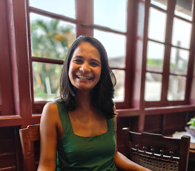

<h1>Rashmi Menon</h1>

  

  
  Delhi, India

<h4>Background</h4>

I work on questions at the intersection of rigorous research and practical implementation. 

 Over the past decade, I've worked across South Asia and sub-Saharan Africa in roles spanning implementation, research, and philanthropy. Through these experiences, I’ve built a perspective shaped by both the practical realities of designing and delivering interventions and the considerations that go into evaluating and funding them. 

 Most recently, I was a Senior Program Manager embedded in the DIV Fund in Washington, DC, where I worked on identifying and funding early-stage innovation as well as supporting the scale-up of evidence-based interventions. I also provided technical advice to applicants on intervention and research design. 

 I’m particularly interested in the gap between evidence and implementation: how promising ideas become effective programs, how organizations and governments learn what works, and how interventions can reach more people. 

<h4>Current Interests</h4>

 I've recently been exploring the evolving needs of secondary education, particularly how to equip children in low- and middle-income countries with the critical reasoning skills necessary to navigate an AI-enabled world. I’m interested in both the changing demands of the workforce, where these skills are increasingly important, as well as the broader societal need for informed citizens who can question claims, evaluate evidence, and form independent judgments. 

 I'm also interested in how global philanthropic funding can better identify and support local innovation. My experiences in global philanthropy have pushed me to think about how smaller, high-potential organizations can access such funding, as well as how donors can discover, evaluate and support a wider range of locally grounded interventions. 

You can see my resume <a href="/resume.pdf">here</a>. 

 Feel free to reach out to me at <a href="mailto:rashmi.tmenon@gmail.com">rashmi.tmenon@gmail.com </a> to chat! 

    <h4>Education</h4>
    <ul>
      <li>Master in Public Administration in International Development (MPA/ID), 2022           
Harvard Kennedy School</li>
      <li>Bachelor of Arts in Economics with Industrial Mathematics and Applied Statistics, 2012
Fergusson College</li>
    </ul>

